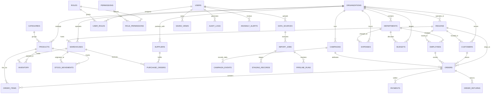

# NEXORA — Entity-Relationship (ER) Architecture

**Document Status:** Approved Baseline (Module 3)  
**Database Engine:** PostgreSQL 16  
**Multi-Tenant Readiness:** Core business entities include `organization_id` foreign key.

---

## 1. Entity Overview & Classification

The Nexora data model is partitioned into two cooperating domains:

### A. Core Business Entities (18 Tables)
1. **`organizations`** — Fictional enterprise boundary (*Nexora Technologies*).
2. **`departments`** — Operational divisions (Sales, Marketing, Finance, Operations, Inventory, Executive).
3. **`regions`** — Geographic sales/distribution territories (North America, Europe, APAC, LATAM, MEA).
4. **`employees`** — Internal sales representatives and department personnel.
5. **`suppliers`** — Vendors providing components and raw units.
6. **`categories`** — Product category taxonomy.
7. **`products`** — Goods catalog with SKU, cost, price, and reorder levels.
8. **`warehouses`** — Physical distribution centers.
9. **`inventory`** — Current stock levels per SKU and warehouse.
10. **`stock_movements`** — Audit trail of stock receipts, reservations, shipments, and adjustments.
11. **`customers`** — Account directory with acquisition metadata and demographic attributes.
12. **`orders`** — Sales transactions with order date, status, channel, discount, and tax totals.
13. **`order_items`** — Order line items with point-in-time unit cost and unit price.
14. **`payments`** — Transaction settlements with method, payment status, and gateway reference.
15. **`order_returns`** — Reverse logistics with return reason, refund amount, and return status.
16. **`campaigns`** — Marketing initiatives with channel, planned budget, and flight dates.
17. **`campaign_events`** — Daily granular performance (spend, impressions, clicks, conversions, attributed revenue).
18. **`purchase_orders`** — Inbound procurement orders with lead times, received units, and defects.
19. **`expenses`** — Departmental operating expense ledger (OpEx).
20. **`budgets`** — Budget targets per department, expense category, and fiscal period.

### B. Platform Governance & Operations Entities (10 Tables)
1. **`users`** — Application accounts (Owner/Admin and internal users).
2. **`roles`** — RBAC role definitions (Owner, Executive, Dept. Manager, Analyst, Data Scientist, Viewer).
3. **`permissions`** — Action-level permission definitions (e.g., `dashboard.view`, `sales.view`, `report.export`).
4. **`role_permissions`** — Many-to-many role-to-permission mapping.
5. **`user_roles`** — Many-to-many user-to-role assignment.
6. **`data_sources`** — Registry of ingested files and external data batches.
7. **`import_jobs`** — Tracked import executions with status, mapping, rows loaded, and errors.
8. **`staging_records`** — Raw uploaded rows preserved before and during cleaning.
9. **`pipeline_runs`** — Observability records of data transformation and pipeline runs.
10. **`saved_views`** — Reusable report/filter presets.
11. **`audit_logs`** — Append-only security and operational audit trail.
12. **`anomaly_alerts`** — Detected statistical and behavioral business anomalies.

---

## 2. Complete Entity-Relationship Diagram

---

## 3. Key Relationships & Referential Integrity Rules

- **Cascading & Protection:**
  - `orders` $\rightarrow$ `order_items`: Deleting an order cascades to its line items (`ON DELETE CASCADE`).
  - `products` $\rightarrow$ `order_items`: A product with sales history cannot be deleted (`ON DELETE RESTRICT`) to preserve accounting integrity.
  - `customers` $\rightarrow$ `orders`: A customer with sales history is protected (`ON DELETE RESTRICT`).
  - `roles` $\rightarrow$ `role_permissions`: Deleting a role cascades to its permission mappings.
- **Organization Boundary:**
  - Every business query filters by `organization_id`, ensuring strict future-ready tenant separation.
