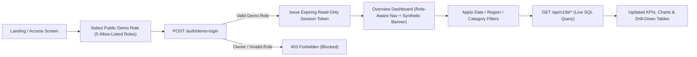
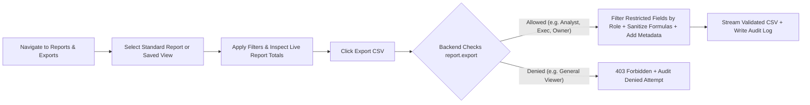
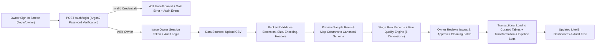
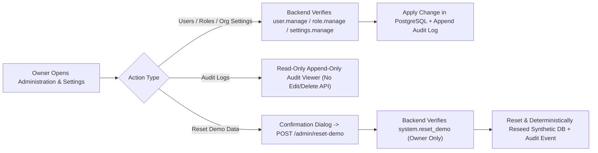

# NEXORA — Product Requirements & Planning Specification

**Document Status:** Approved Baseline (Module 1)  
**Product Name:** Nexora – Enterprise Data Intelligence & Business Analytics Platform  
**Fictional Demonstration Organization:** Nexora Technologies (`USD`, `UTC`)  
**Scope Version:** v1.0 (Local-First Portfolio Application)

---

## 1. One-Page Product Brief

### 1.1 Executive Summary
**Nexora** is a local-first, full-stack Enterprise Data Intelligence & Business Analytics Platform built for a fictional multi-region enterprise (*Nexora Technologies*). It provides a unified environment where raw business data (synthetic or CSV-uploaded) is validated, cleaned with traceable provenance, stored in PostgreSQL, analyzed via centralized Python analytics and statistical services, evaluated with genuine machine learning models, monitored for anomalies, and presented through interactive role-aware dashboards and controlled reports.

### 1.2 Problem Statement
Organizations commonly store operational data in disconnected spreadsheets, CRM exports, accounting tables, and inventory logs. This fragmentation causes:
1. **Fragmented visibility** — no unified cross-functional view of revenue, cost, inventory, marketing, operations, and suppliers.
2. **Slow, inconsistent decision-making** — teams calculate KPIs differently across ad-hoc spreadsheets.
3. **Error-prone manual data preparation** — missing values, duplicates, malformed dates, and inconsistent categories degrade trust.
4. **Purely backward-looking reporting** — lack of forecasting and churn prediction prevents proactive action.
5. **Unnoticed operational anomalies** — revenue drops, abnormal transactions, campaign overspend, and stock depletions surface too late.
6. **Uncontrolled reporting** — no centralized permission-checked reporting or audit trail.

### 1.3 Target Users
- **Owner / Administrator (Private Account):** Manages data ingestion, cleaning approvals, users, roles, permissions, organization settings, pipeline monitoring, audit logs, and demo resets.
- **Executive / CEO (Public Demo — Read-Only):** Monitors company-wide financial health, revenue growth, customer trajectory, inventory risk, anomalies, and predictive outlooks.
- **Department Manager (Public Demo — Read-Only):** Tracks departmental execution across sales, marketing, operations, and supplier performance (default focus: Sales).
- **Data Analyst (Public Demo — Read-Only):** Explores granular tables, multi-dimensional filters, drill-downs, descriptive statistics, reports, and permitted CSV exports.
- **Data Scientist (Public Demo — Read-Only):** Inspects inferential statistical tests, correlations, regressions, ML evaluation metrics, forecasts, churn risk scores, and anomaly baselines.
- **General Viewer (Public Demo — Read-Only):** Explores high-level dashboards and summary reports without export or write privileges.

### 1.4 Core Capabilities (In Scope for v1.0)
- **End-to-end data pipeline:** CSV Upload → Validation → Raw/Staging Preservation → Documented Cleaning & 5-Dimension Data Quality Scoring → Curated PostgreSQL Storage → Analytics/ML/Anomaly Services → React + TypeScript Visualizations.
- **8 Core Business Intelligence Sections:** Overview, Sales, Customers, Marketing, Finance, Inventory, Operations, and Suppliers—100% backed by live PostgreSQL queries.
- **3 Advanced Analytics Sections:** Statistical Analysis, Predictive Analytics (at least 2—targeting 3—trained and evaluated models), and Anomaly & Risk Intelligence.
- **3 Data Operations Sections:** Data Sources & Integration, Data Quality & Pipeline Monitoring, and Reports & Exports (with saved views and permission-checked CSV exports).
- **1 Administration Section:** Users, Roles, Permissions, Departments, Organization Settings, Append-Only Audit Logs, and Owner-Only Demo Reset.
- **Backend-Enforced RBAC:** Separate Owner authentication vs. controlled read-only Demo Role entry with HTTP 401/403 enforcement on every protected endpoint.
- **Deterministic Synthetic Data & Clean Reproducibility:** Full local Docker Compose PostgreSQL setup, Alembic migrations, deterministic seeding, and repeatable test suites.

### 1.5 Explicit Non-Goals (Deferred Beyond v1.0)
1. Public cloud deployment / production hosting / CI-CD infrastructure.
2. Mobile native apps (App Store / Play Store).
3. Real company onboarding or commercial SaaS subscription/billing management.
4. Enterprise SSO / SAML / OIDC identity federation.
5. Complex multi-tenant isolation or production row-level security (schema includes `organization_id` for future readiness only).
6. Paid third-party BI embeddings (Power BI / Tableau) or paid external APIs.
7. Real-time streaming infrastructure (Kafka/Flink) or premature Redis/Celery workers unless strictly required.
8. Production compliance certification (SOC 2, ISO 27001, GDPR legal certification).
9. Unvalidated deep learning or excessive ML algorithm proliferation.

---

## 2. Navigation Map & 15-Section Screen Inventory

Every route sits inside a unified enterprise application shell with role-aware sidebar navigation, top bar (role badge, synthetic-data indicator, global breadcrumbs, session menu), consistent loading/empty/error states, and backend-enforced permissions.

### Navigation Hierarchy
```text
Nexora Workspace
├── Group A: Business Intelligence
│   ├── 1. Overview Dashboard            (/overview)
│   ├── 2. Sales Intelligence            (/sales)
│   ├── 3. Customer Intelligence         (/customers)
│   ├── 4. Marketing Intelligence        (/marketing)
│   ├── 5. Financial Intelligence        (/finance)
│   ├── 6. Inventory Intelligence        (/inventory)
│   ├── 7. Operations Intelligence       (/operations)
│   └── 8. Supplier Intelligence         (/suppliers)
├── Group B: Advanced Analytics
│   ├── 9. Predictive Analytics          (/predictions)
│   ├── 10. Anomaly & Risk Intelligence  (/anomalies)
│   └── 11. Statistical Analysis         (/statistics)
├── Group C: Data Operations
│   ├── 12. Data Sources & Integration   (/data-sources)
│   ├── 13. Data Quality & Pipelines     (/data-quality)
│   └── 14. Reports & Exports            (/reports)
└── Group D: Administration
    └── 15. Administration & Settings    (/administration)
```

### Detailed 15-Section Screen Inventory

| # | Section | Purpose | Primary User Questions | Required Metrics | Filters | Tables | Charts | Actions |
| :-: | :--- | :--- | :--- | :--- | :--- | :--- | :--- | :--- |
| **1** | **Overview Dashboard** | Consolidated executive snapshot of Nexora Technologies. | How is the business performing overall vs. prior period? Where are the biggest risks or wins? | Net Revenue, Total Expenses, Gross Profit, Net Profit, Total Orders, Total & Active Customers, AOV, New Customers, Marketing Spend, Inventory Value, Fulfilment Rate, Period-over-Period % Delta. | Date range, Region, Comparison period (prior period / YoY). | Recent Business Activities; Active High-Severity Alerts. | Revenue & Profit Trend (line/area); Sales by Region (bar); Top Products (bar); Customer Growth (line); Marketing Spend vs. Attributed Revenue. | Filter, drill-down links to Sections 2–8 & 10. |
| **2** | **Sales Intelligence** | Deep analysis of sales volume, revenue, products, regions, and channels. | Which regions, categories, products, channels, and reps drive growth or underperform? | Gross Revenue, Net Revenue, Order Count, Units Sold, AOV, Sales Growth %, Discount Rate, Revenue by Region/Product/Category/Channel/Salesperson. | Date range, Region, Product, Category, Sales Channel, Customer Segment. | Top & Bottom Products; Regional Breakdown; Salesperson Leaderboard; Drill-Down Order Ledger (paginated/sortable). | Monthly/Quarterly/Yearly Revenue Trend; Revenue by Category (bar); Revenue by Region (bar); Channel Mix (donut). | Multi-filter, chart-to-table drill-down, sort/paginate, open Sales Report. |
| **3** | **Customer Intelligence** | Behavioral, retention, segmentation, and lifetime value analysis. | Who are our highest-value, loyal, and at-risk customers? How well do cohorts retain? | Total, New, Returning, Active, Inactive Customers; Repeat Purchase Rate; Retention Rate; Churn Rate; Purchase Frequency; Avg Customer Spend; Historical & Estimated CLV; Segment Distribution. | Date range, Region, Customer Segment, Acquisition Channel. | Customer Directory (paginated, segmented); Segment Comparison Table; Cohort Retention Matrix. | Customer Acquisition Trend (line); Segment Revenue vs. Count (grouped bar); Cohort Retention Heatmap/Table; Geographic Customer Distribution (bar). | Filter, inspect customer profile/segment criteria, drill-down into segment records. |
| **4** | **Marketing Intelligence** | Campaign funnel, cost efficiency, and ROI analysis. | Which campaigns and channels produce the highest conversions and ROAS? | Total Spend, Campaign Count, Impressions, Clicks, Conversions, CTR, Conversion Rate, CPC, CPA, ROAS, Monthly Spend. | Date range, Channel, Campaign Status, Region/Target Segment. | Campaign Performance Table; Channel Summary Table. | Monthly Spend vs. Attributed Revenue (combo/bar); ROAS by Channel (bar); Funnel Comparison (Impressions → Clicks → Conversions). | Filter, compare campaigns, inspect metric formulas & missing-field notices. |
| **5** | **Financial Intelligence** | Revenue, COGS, operating expenses, profitability, and budget variance. | Are margins healthy? Where are expenses exceeding budget by department or region? | Net Revenue, COGS, Gross Profit, Gross Margin %, Operating Expenses, Net Profit, Net Margin %, Budget vs. Actual Variance ($ and %), Expense Ratio. | Date range (Monthly/Quarterly/Annual), Region, Department/Business Unit, Expense Category. | P&L Summary Table; Budget vs. Actual Table; Expense Ledger Breakdown. | Revenue vs. Expenses vs. Profit Trend (multi-line); Expense by Category (bar/donut); Budget vs. Actual by Department (grouped bar); Regional Margin Comparison. | Filter, toggle monthly/quarterly granularity, view explicit synthetic-assumption banner & formulas. |
| **6** | **Inventory Intelligence** | Stock health, valuation, turnover, ageing, and replenishment planning. | Which SKUs are out-of-stock, low-stock, over-aged, or fast-moving across warehouses? | Total SKUs, Available Stock Units, Reserved Units, Out-of-Stock Count, Low-Stock Count, Inventory Valuation, Inventory Turnover, Stock Ageing Buckets, Reorder Alerts. | Warehouse, Category, Stock Status (Healthy/Low/Out), Date range (for movements/turnover). | Product Stock Table (with reorder status); Warehouse Summary; Stock Movement History; Reorder Alert Queue. | Stock Valuation by Warehouse (bar); Stock Status Breakdown (donut); Stock Ageing Distribution (bar); Top Moving SKUs Demand vs. Stock. | Filter, inspect reorder alerts, view linked demand forecast (post-Module 12). |
| **7** | **Operations Intelligence** | Order lifecycle efficiency, fulfilment speed, returns, and bottlenecks. | How fast are orders fulfilled and delivered? Where are delays, cancellations, or return spikes? | Total Processed Orders, Completed, Pending, Cancelled, Returned Orders; Fulfilment Rate; Avg Fulfilment Time (hrs/days); On-Time Delivery Rate; Return Rate; Operational Cost; SLA Compliance %. | Date range, Region, Warehouse, Order Status, Sales Channel. | Operational Bottlenecks Table; Delayed/Returned Orders Table; Return Reasons Summary. | Order Status Pipeline (bar); Avg Fulfilment & Delivery Trend (line); Return Rate by Category/Region (bar); Operational Cost Trend. | Filter, drill-down into delayed/returned orders, inspect SLA thresholds. |
| **8** | **Supplier Intelligence** | Procurement spend, lead times, delivery reliability, and defect tracking. | Which suppliers deliver on time at competitive cost and acceptable quality? | Total Suppliers, Active Suppliers, PO Count, Total Supplier Spend, Avg Delivery Lead Time (days), On-Time Delivery Rate %, Defect/Return Rate %, Cost Variance. | Date range, Region, Supplier Status, Category. | Supplier Scorecard Table; Purchase Order History (paginated/sortable). | Supplier Spend Comparison (bar); Lead Time vs. On-Time Rate (scatter/bar); Defect Rate by Supplier (bar); Monthly Procurement Spend. | Filter, compare suppliers side-by-side, drill-down into PO history. |
| **9** | **Predictive Analytics** | Genuine trained ML & time-series forecasting with transparent evaluation. | What are expected future sales, which customers are likely to churn, and what product demand is projected? | **Sales Forecast:** Predicted Revenue, Horizon, Confidence Band, Baseline vs. Candidate MAE/RMSE/MAPE. **Churn:** Churn Probability, Risk Tier (High/Med/Low), Precision/Recall/F1/ROC-AUC. **Demand:** Forecasted Units, MAE/RMSE. Model Metadata (version, trained_at, range, features). | Model selector, Forecast horizon (30/60/90 days or 3/6 months), Region/Category/Product (where supported), Risk Tier. | High-Risk Churn Customers Table; Product Demand Forecast Table; Model Comparison & Metadata Table. | Historical vs. Forecasted Sales (line + uncertainty band); Churn Risk Distribution (bar); Feature Importance Chart; Baseline vs. Candidate Evaluation Chart. | Run interactive prediction/inference via API, inspect limitations & freshness notice, (Owner) trigger model reload/view artifacts. |
| **10** | **Anomaly & Risk Intelligence** | Automated detection, scoring, explanation, and triage of unusual business patterns. | What unusual drops, spikes, or depletions occurred, why were they flagged, and have they been reviewed? | Open Anomalies, Critical/High/Medium/Low Counts, Observed Value, Expected Baseline, Deviation ($ / % / Z-score), Severity, Status (Open / Acknowledged / Resolved). | Date range, Domain (Sales/Transaction/Inventory/Marketing), Severity, Status. | Anomaly Alert Feed Table (sortable/filterable) with Entity, Metric, Observed vs. Baseline, Deviation, Severity, Status. | Anomaly Timeline Overlay (Observed vs. Baseline Band); Anomalies by Domain & Severity (stacked bar). | Inspect detailed plain-language explanation (never falsely labeled fraud); (Owner) acknowledge/update status & trigger detection run. |
| **11** | **Statistical Analysis** | Descriptive and inferential statistical workbench with methodological guardrails. | What are the statistical properties, distributions, correlations, regressions, and significant group differences in our data? | Count, Missing Count, Mean, Median, Mode(s), Min, Max, Variance, Std Dev, Quartiles (Q1/Q2/Q3), Percentiles (P5–P95), Pearson/Spearman $r$ & $p$-value, Covariance, OLS $R^2$/coefficients, Test Statistic & $p$-value, 95% CI. | Dataset/Entity selector, Numeric Variable(s), Grouping Variable, Test Type (t-test, Mann-Whitney, ANOVA, Chi-Square, OLS), Confidence Level, Date/Region scope. | Summary Statistics Table; Correlation Matrix; Regression Coefficient Table; Hypothesis Test Output Table. | Histogram & Distribution Curve; Boxplot / Quartile Summary; Scatter Plot with Regression Line; Time-Series Trend/Decomposition Plot. | Run reproducible analysis via backend API, read method/assumption/limitation notes (explicitly warning *correlation ≠ causation*). |
| **12** | **Data Sources & Integration** | Owner-managed data source registry and modular CSV ingestion wizard. | What datasets have been uploaded, how are columns mapped, and did imports succeed cleanly? | Total Sources, Successful/Failed Imports, Rows Uploaded/Loaded/Rejected, File Size, Upload Timestamp, Checksum/Idempotency Status. | Source Type, Target Entity, Import Status, Date range. | Data Source Registry Table; Import Job History Table; Column Mapping & 20-Row Preview Grid. | Import Volume & Success Trend (bar). | (Owner) Upload CSV, validate file, map incoming headers to canonical fields, preview rows, confirm transactional import, inspect errors or reverse/rollback staging. |
| **13** | **Data Quality & Pipeline Monitoring** | Explainable data-quality scoring, raw-to-curated transformation logs, and pipeline observability. | How trustworthy is each dataset across the 5 quality dimensions, what was cleaned, and what is the pipeline status? | Completeness %, Validity %, Uniqueness %, Consistency %, Timeliness %, Overall Quality Score, Issue Counts by Rule, Pipeline Duration, Last Successful Refresh, Rows Processed/Rejected. | Source/Dataset, Quality Dimension, Rule Severity, Pipeline Status, Date range. | Quality Issue Breakdown (with sample problematic rows & remediation); Transformation Audit Log; Pipeline Run History Table. | 5-Dimension Quality Score Breakdown (bar/radar); Quality Score Trend Over Time (line); Pipeline Success vs. Failure History. | Inspect raw vs. curated diff & sample bad rows; (Owner) approve/reject cleaning batch, safely retry eligible failed jobs. |
| **14** | **Reports & Exports** | Centralized report catalogue, reusable saved filter views, and controlled downloads. | Which standardized business reports are available, how can I reuse filter presets, and what can I export? | Report Metadata (name, category, owner, updated_at, row count) + live report-specific KPIs across 8 standard reports (Monthly Sales, Quarterly Financial, Customer Retention, Marketing Performance, Inventory Health, Supplier Performance, Operational Efficiency, Predictive Summary). | Report Category, Date range, Region, Category/Department (per report). | Report Catalogue Grid/Table; Active Report Data Table; Saved Views List. | Summary visual per report aligned with BI screens. | View report, apply/restore Saved Views, export sanitized CSV (with metadata header + synthetic notice) if role has `report.export`; (Owner) create/delete DB Saved Views. |
| **15** | **Administration & Settings** | Owner-only platform governance, RBAC visibility, audit trail, and safe demo reset. | Who has access to what, what sensitive actions occurred, how is the organization configured, and how do I reset demo data? | Active Users, Role Count, Permission Count, Audit Event Count, Org Currency/Timezone, Synthetic Dataset Status, Last Seed/Reset Time. | Audit Action Type, Actor, Date range, User Role/Status. | Users Table; Roles & Permissions Matrix Table; Departments Table; Append-Only Audit Log Table. | Audit Activity Over Time (bar). | (Owner only) Create/toggle users, inspect/update non-system role permissions, manage departments & org settings, inspect append-only audit logs, execute protected Demo Data Reset & Reseed. |

---

## 3. Roles & Permissions Matrix

### 3.1 Access Categories
1. **Public Demo Roles (Strictly Read-Only at Backend & Database):** Selected via controlled allow-listed demo login (`POST /api/v1/auth/demo-login`). No demo role may ever mutate business records, upload/import data, modify users/roles/settings, alter audit logs, or escalate to Owner.
2. **Owner / Administrator (Private Authenticated Account):** Authenticated via dedicated owner credentials (`POST /api/v1/auth/login`) with Argon2-hashed password configured via local `.env` / setup script. Never selectable through the public demo selector.

### 3.2 Complete Permission Vocabulary & Role Matrix

Legend: **Y** = Permitted (Backend enforced) · **N** = Denied (`HTTP 403 Forbidden`)

| Permission Code | Description | Owner / Admin | Executive | Dept. Manager | Data Analyst | Data Scientist | General Viewer |
| :--- | :--- | :---: | :---: | :---: | :---: | :---: | :---: |
| `dashboard.view` | View Overview Dashboard | **Y** | **Y** | **Y** | **Y** | **Y** | **Y** |
| `sales.view` | View Sales Intelligence & order drill-downs | **Y** | **Y** | **Y** | **Y** | **Y** | **Y** |
| `customer.view` | View Customer Intelligence & segments | **Y** | **Y** | **Y** | **Y** | **Y** | **Y** |
| `customer.create` | Create customer records | **Y** | N | N | N | N | N |
| `customer.update` | Update customer records | **Y** | N | N | N | N | N |
| `customer.delete` | Delete customer records | **Y** | N | N | N | N | N |
| `marketing.view` | View Marketing Intelligence | **Y** | **Y** | **Y** | **Y** | **Y** | **Y** |
| `finance.view` | View Financial Intelligence (P&L, budgets) | **Y** | **Y** | N | **Y** | **Y** | N |
| `inventory.view` | View Inventory Intelligence | **Y** | **Y** | **Y** | **Y** | **Y** | **Y** |
| `operations.view` | View Operations Intelligence | **Y** | **Y** | **Y** | **Y** | **Y** | **Y** |
| `supplier.view` | View Supplier Intelligence | **Y** | **Y** | **Y** | **Y** | **Y** | **Y** |
| `statistics.view` | View & execute read-only statistical analyses | **Y** | **Y** | **Y** | **Y** | **Y** | N |
| `predictions.view` | View & run read-only ML predictions/forecasts | **Y** | **Y** | **Y** | **Y** | **Y** | N |
| `predictions.manage` | Trigger model training/reload metadata actions | **Y** | N | N | N | N | N |
| `anomaly.view` | View Anomaly & Risk Intelligence feed | **Y** | **Y** | **Y** | **Y** | **Y** | **Y** |
| `anomaly.acknowledge` | Acknowledge or update anomaly alert status | **Y** | N | N | N | N | N |
| `datasource.view` | View data source registry & import history | **Y** | **Y** | N | **Y** | **Y** | N |
| `datasource.import` | Upload CSV, map columns, execute imports | **Y** | N | N | N | N | N |
| `dataquality.view` | View data quality scores & pipeline runs | **Y** | **Y** | N | **Y** | **Y** | N |
| `dataquality.manage` | Approve/reject cleaning runs & retry pipelines | **Y** | N | N | N | N | N |
| `report.view` | View report catalogue & pre-saved views | **Y** | **Y** | **Y** | **Y** | **Y** | **Y** |
| `report.export` | Export permitted report CSV (and optional PDF) | **Y** | **Y** | **Y** | **Y** | **Y** | **N** |
| `report.sensitive_fields` | Include internal unit cost / margin / customer contact fields in exports | **Y** | **Y** | N | **Y** | **Y** | **N** |
| `saved_view.manage` | Create, update, delete DB-persisted saved views | **Y** | N | N | N | N | N |
| `user.manage` | View/create/toggle users & assign roles | **Y** | N | N | N | N | N |
| `role.manage` | View/modify non-owner role permissions | **Y** | N | N | N | N | N |
| `audit.view` | View append-only audit logs | **Y** | N | N | N | N | N |
| `settings.manage` | Manage org settings, departments & system config | **Y** | N | N | N | N | N |
| `system.reset_demo` | Reset & reseed local demonstration dataset | **Y** | N | N | N | N | N |

### 3.3 Security & Policy Rules
- **No Unauthenticated Access:** Any call to protected endpoints without a valid, non-expired, non-revoked session token returns **`HTTP 401 Unauthorized`**.
- **Strict Permission Enforcement:** Authenticated calls lacking the endpoint's required permission return **`HTTP 403 Forbidden`**.
- **Owner Isolation:** `POST /api/v1/auth/demo-login` explicitly allow-lists only `[executive, department_manager, data_analyst, data_scientist, general_viewer]`. Attempting to request `owner` / `admin` returns `HTTP 403`.
- **Saved Views for Demo Users:** Demo roles can read and restore pre-seeded DB saved views (and optionally use client-side session filter presets labeled *browser-only*), while DB writes remain 100% blocked for all demo roles.
- **Department Manager Default Scope:** Opens Sales/Operations/Marketing with default department context *Sales*, while Financial Intelligence (`finance.view`) and Administration remain restricted.

---

## 4. User-Flow Diagrams (Core Journeys)

### 4.1 Public Demo Entry, Role Selection, Dashboard & Filtering Journey


### 4.2 Reporting & Permitted Export Journey


### 4.3 Owner Login, CSV Data Ingestion & Cleaning Journey


### 4.4 Owner Administration & Protected Reset Journey


---

## 5. Prioritized Backlog & Measurable Acceptance Criteria

### Priority Classification
- **Must-Have (v1.0 Mandatory):** Required to satisfy the Master Specification, Roadmap Completion Gates, and all 205 Mandatory Test Cases.
- **Should-Have (v1.0 High Value):** Included in v1.0 if clean, stable, and passing tests without adding fragility.
- **Later (Post-v1.0 Backlog):** Explicitly deferred beyond v1.0.

### Prioritized Feature Backlog

| ID | Feature / Module Area | Priority | Target Module | Measurable Acceptance Criteria |
| :--- | :--- | :--- | :---: | :--- |
| **BL-01** | Product Spec, Navigation Map, RBAC Matrix, Metric Dictionary, Test Plan | Must-Have | M1 | All 15 sections, 6 roles, 9 user journeys, core metric formulas, and 205 test cases documented and verified (`M1-T01`–`M1-T06` PASS). |
| **BL-02** | Git Repo, Vite/React/TS + FastAPI Starters, Docker PostgreSQL 16, Linters, Health Check | Must-Have | M2 | Clean install works; Docker PostgreSQL starts; `/api/v1/health` returns 200; frontend renders live health status; ruff/mypy/eslint/tsc pass (`M2-T01`–`M2-T10` PASS). |
| **BL-03** | ER Diagram, Alembic Migrations, Deterministic Synthetic Seeder & Reset Scripts | Must-Have | M3 | Empty DB migrates cleanly; deterministic seeder produces identical counts across resets; zero orphan FKs; all fields documented in `data-dictionary.md` (`M3-T01`–`M3-T11` PASS). |
| **BL-04** | Modular FastAPI Architecture, SQLAlchemy Sessions, Pagination/Sort/Filter, OpenAPI | Must-Have | M4 | Paginated, sorted, multi-filtered endpoints read live DB rows; invalid inputs return consistent 422 JSON; exceptions never leak stack traces (`M4-T01`–`M4-T11` PASS). |
| **BL-05** | Owner Auth (Argon2 + Revocable Sessions), Allow-Listed Demo Login, Backend RBAC | Must-Have | M5 | Owner authenticates; only 5 demo roles selectable; direct API writes by demo roles return 403; unauthenticated/expired/logged-out tokens return 401 (`M5-T01`–`M5-T12` PASS). |
| **BL-06** | Enterprise App Shell, Design Tokens, Role-Aware Nav, Reusable UI Kit | Must-Have | M6 | Shared layout, KPI cards, sortable/paginated tables, chart panels, filter bar, date selector, and loading/empty/error states work across laptop/tablet widths with keyboard access (`M6-T01`–`M6-T12` PASS). |
| **BL-07** | Owner CSV Upload, Validation, Column Mapping, Preview, Transactional Import & History | Must-Have | M7 | Owner uploads/maps/previews/imports CSVs cleanly; invalid/oversized/malformed files fail safely; mid-import failure rolls back cleanly; demo uploads blocked (`M7-T01`–`M7-T13` PASS). |
| **BL-08** | Reusable Cleaning Library, 5-Dimension Quality Engine, Raw-to-Curated Provenance & Approval | Must-Have | M8 | Deliberately messy CSV produces exact repeatable counts for missing/duplicate/invalid-date/numeric/category/FK issues; quality scores match manual math; raw rows preserved (`M8-T01`–`M8-T12` PASS). |
| **BL-09** | All 8 Core BI Modules (Overview, Sales, Customers, Marketing, Finance, Inventory, Ops, Suppliers) | Must-Have | M9 | Zero hard-coded analytics; every KPI matches independent SQL reconciliation; date/region/category/segment filters update queries; chart-to-table drill-downs reconcile (`M9-T01`–`M9-T17` PASS). |
| **BL-10** | Report Catalogue, Saved Views, Sanitized Permission-Checked CSV Export | Must-Have | M10 | 8 structured reports match DB totals; saved views store/restore filters; CSV exports match UI totals, include metadata + synthetic notice, neutralize formula injection, enforce role/field permissions (`M10-T01`–`M10-T11` PASS). |
| **BL-11** | Server-Side PDF Report Export | Should-Have | M10 | Implemented via ReportLab only if layout, page breaks, and numbers pass `M10-T12`; otherwise cleanly omitted with no broken button. |
| **BL-12** | Statistical Analysis Service & UI (Descriptive, Distribution, Correlation, Regression, Hypothesis Tests, CI) | Must-Have | M11 | All calculations verified against known mathematical oracle datasets; missing-data exclusions, sample sizes, assumptions, and *correlation ≠ causation* warnings shown (`M11-T01`–`M11-T13` PASS). |
| **BL-13** | Predictive Analytics — Sales Forecasting & Customer Churn Prediction | Must-Have | M12 | Leakage-free splits, baseline vs. candidate comparison, MAE/RMSE & Precision/Recall/F1/ROC-AUC stored in `artifacts/model_metadata/`, repeatable training script, live inference API & UI (`M12-T01`–`M12-T17` PASS). |
| **BL-14** | Predictive Analytics — Product Demand Forecasting (3rd Model + Inventory Integration) | Should-Have | M12 | Same leakage-free evaluation and metadata standards; surfaces projected demand inside Predictions and Inventory Intelligence. |
| **BL-15** | Anomaly & Risk Intelligence (Statistical Baselines, Severity, Explanations, Acknowledgement) | Must-Have | M13 | Detects injected sales, transaction, inventory, and marketing anomalies; normal data not over-flagged; deduplication works; plain-language explanations; RBAC-gated acknowledgement (`M13-T01`–`M13-T12` PASS). |
| **BL-16** | Optional Isolation Forest Anomaly Detector | Should-Have | M13 | Included only if comparative benchmark against statistical baseline demonstrates documented value (`M13-T13`). |
| **BL-17** | Pipeline Monitoring, Safe Retries, Append-Only Audit Logs, Admin Screens, Owner-Only Reset | Must-Have | M14 | End-to-end trace from upload to curated data; failed runs don't overwrite last successful refresh; append-only audit logs cannot be edited/deleted; owner admin & demo reset work (`M14-T01`–`M14-T13` PASS). |
| **BL-18** | Full-System Integration, Security Hardening, Performance Indexing, Backup/Restore & QA Gate | Must-Have | M15 | All backend/frontend/E2E/security/CORS/upload/backup-restore/reset tests pass with zero unresolved Critical/High defects (`M15-T01`–`M15-T20` PASS). |
| **BL-19** | Complete Documentation, Walkthroughs & Clean-Environment Reproducibility Verification | Must-Have | M16 | Fresh isolated setup strictly following README initializes DB, seeds data, passes tests, and runs full app without manual repair (`M16-T01`–`M16-T13` PASS). |
| **BL-20** | Excel (`.xlsx`) Upload Support | Later | Post-v1 | Add `.xlsx` parser adapter into modular ingestion pipeline after v1 CSV pipeline is proven. |
| **BL-21** | Public Cloud Deployment, Enterprise SSO, Multi-Tenant RLS, Celery/Redis Workers | Later | Post-v1 | Explicitly out of v1 local portfolio scope. |
